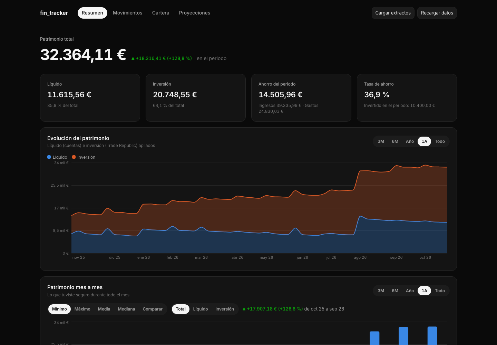
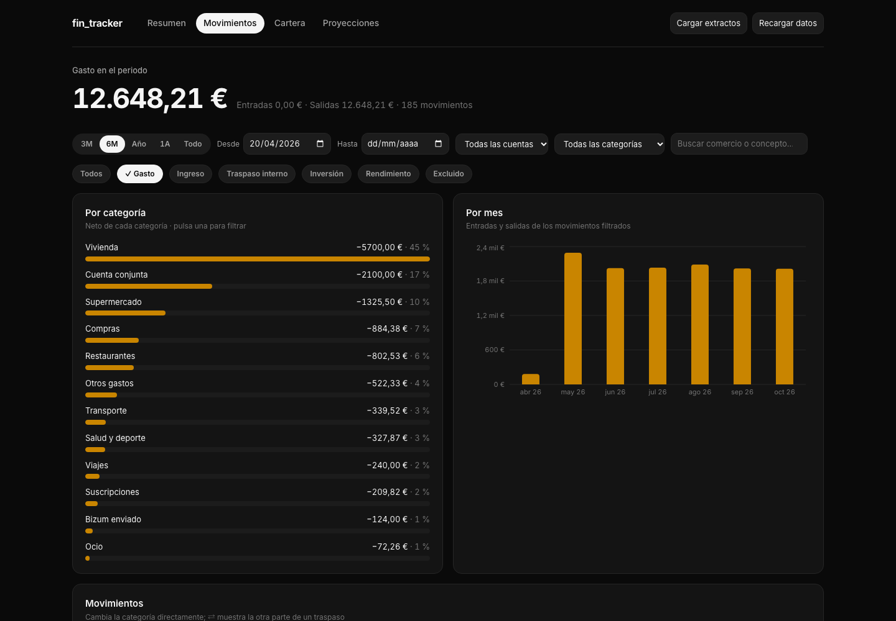
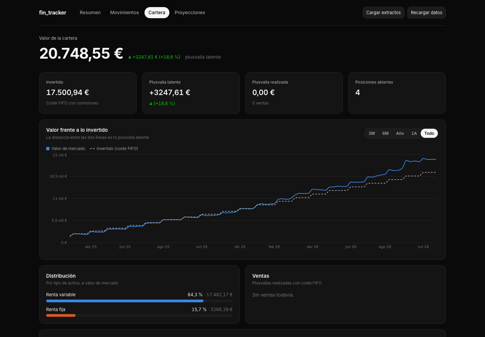
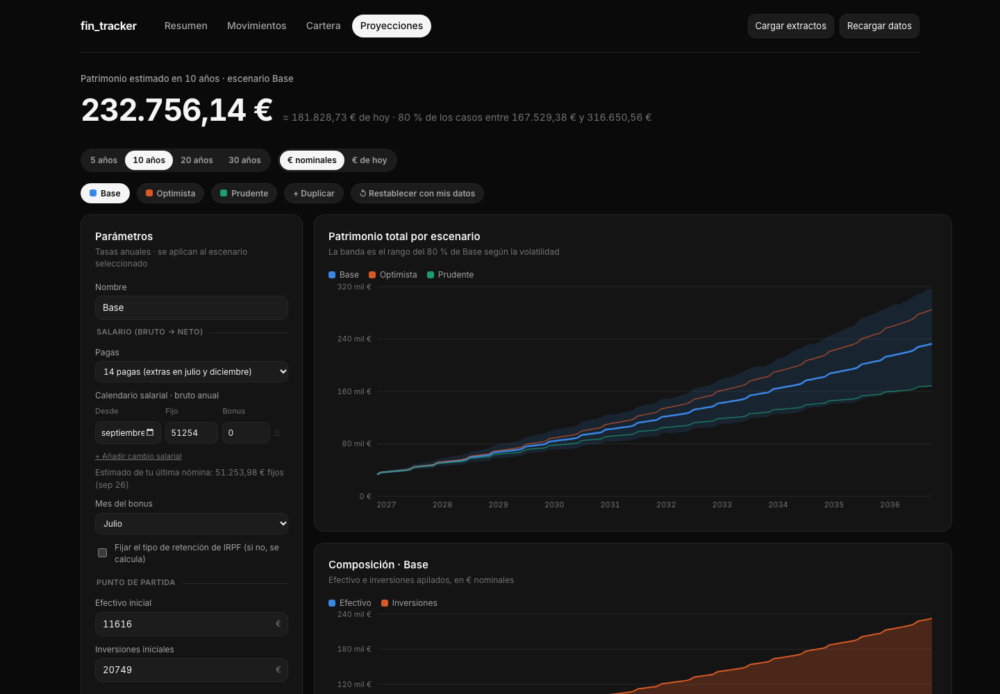

# fin_tracker

A personal finance app that turns raw bank exports into one consistent ledger: net worth split into cash and investments, spending by category, a FIFO-valued portfolio and 10–30 year projections with a Spanish payroll and tax model.

I built it for my own money: a salary account at BBVA, day-to-day spending and a joint account at Revolut, and investing at Trade Republic. None of those apps sees the whole picture, and none knows that moving money between them is not spending.



> Every screenshot here comes from **demo mode**: a synthetic persona generated offline. No real data is in this repo.

## Try it in two minutes

You need [uv](https://docs.astral.sh/uv/) and Node 20+.

```bash
git clone https://github.com/alexbs1700/fin_tracker.git && cd fin_tracker
uv sync
npm --prefix frontend ci && npm --prefix frontend run build
uv run fin-tracker-api --demo
```

Open http://127.0.0.1:8000. Demo mode writes 20 months of made-up extracts to `data/demo/` in each bank's real file format, and swaps Yahoo Finance for deterministic price paths. It works offline, gives the same numbers on every run, and never touches `data/raw`.

## What it does

| Page | |
|---|---|
| **Resumen** | Net worth (cash vs. investments) over time, monthly stats, savings rate, cash flow per month. |
| **Movimientos** | Every transaction from every bank in one table. One set of filters (period, account, flow type, category, text) drives the table and every summary. Categories can be corrected inline. |
| **Cartera** | Positions valued at market price, cost basis with FIFO, unrealized and realized gains, allocation by asset class, value vs. invested over time. |
| **Proyecciones** | Monthly simulation of cash and investments with several scenarios, Monte Carlo bands (p10–p90), a gross-to-net salary calendar and an investing plan (fixed amount or % of each payslip). Defaults are estimated from the last 12 months of real data. |

<p>
  
  
</p>



It is also an installable PWA. On the home WiFi the iPhone can open it, protected by an access key that the Mac itself never needs.

## The interesting parts

**Three extract formats, one schema.** BBVA exports an xlsx (newest first). Revolut exports one CSV holding a separate table per wallet, Spanish number formats and multi-currency columns. Trade Republic exports a tidy CSV whose `amount` *excludes* fees and taxes, while Revolut's *includes* them. Each parser maps to a single `UNIFIED_SCHEMA` with one sign convention: income +, spending −.

**Uploads are validated, not trusted.** For banks with a running balance, every row must satisfy `balance = previous balance + amount`. On real data this holds for 100% of rows, so any break means the file was misread and the upload is blocked. The old extract is backed up before it is replaced.

**Transfers are not spending.** A YAML rule engine (first match wins, user-editable) gives every row a `flow_type`: `income`, `expense`, `internal_transfer`, `investment`, `investment_income` or `excluded`. Transfer legs are then paired across accounts by amount, a date window and FX tolerance, and both legs share a `transfer_id`. An unpaired leg is surfaced for review instead of silently counting as spending.

**Shared money is modelled explicitly.** The joint account has an ownership share of 0: its movements are `excluded`, and my contributions to it count as an expense.

**Spanish rules where they matter.** Cost basis uses FIFO, fees included, as Spanish tax law requires. The payroll model applies Social Security (6.5%, capped base), IRPF withholding on the national scale, 14 payments with extras in July and December, and settles the real state + Madrid tax liability every June. Against my real payslip it is within about 1%.

**Projections grounded in my data.** Starting balances, salary (inverted from the latest regular payslip), expenses, the share of salary invested and the cash yield come from the last 12 complete months. Expected return and volatility are weighted by the portfolio's asset classes. Monte Carlo uses lognormal monthly returns with a fixed seed.

## Architecture

```
data/raw/*.xlsx|csv ──► ingestion/  (one parser per bank → unified schema, upload validation)
                           │
                           ▼
                   categorization/  (YAML rules → flow type + category, transfer pairing,
                           │         manual overrides)
             ┌─────────────┼──────────────────┐
             ▼             ▼                  ▼
        portfolio/      history/        projections/ + taxes/
     (FIFO, yfinance)  (daily cash,     (payroll, scenarios,
                        net worth)       Monte Carlo)
             └─────────────┼──────────────────┘
                           ▼
              api/  FastAPI, cached in-memory store
                           │
                           ▼
          frontend/  React 19 + TypeScript + TanStack Query + Recharts
```

- **Backend:** Python 3.12, pandas, FastAPI, yfinance (prices cached as CSV, only the missing tail is downloaded).
- **Frontend:** React 19, Vite, TypeScript, TanStack Query, Recharts. Pure logic lives in `src/lib` with its own unit tests.
- **Quality:** pytest on synthetic data with yfinance faked, vitest, `tsc --noEmit`, ruff, pre-commit (including nbstripout so notebook outputs never get committed).

## Using it with your own data

1. Copy `.env.example` to `.env` and set `OWNER_NAME`. It is used to recognise transfers to yourself.
2. Put your extracts in `data/raw/` (`bbva_full_data.xlsx`, `revolut_full_data.csv`, `tr_full_data.csv`), or upload them from the app with "Cargar extractos".
3. `uv run fin-tracker-api`, or `uv run fin-tracker` for a terminal net worth summary.
4. Adjust `config/categories.yaml` to your merchants. Ticker overrides and asset classes live in `src/fin_tracker/config.py`.

`data/` and `.env` are gitignored. Supporting another bank means one parser plus one entry in `ingestion/banks.py`.

## Development

```bash
uv run pytest                                      # backend tests
npm --prefix frontend test                         # frontend tests
npm --prefix frontend run typecheck
uv run ruff format . && uv run ruff check --fix .
uv run fin-tracker-api --demo & npm --prefix frontend run dev   # hot reload on :5173
```

## Limitations

Built for one person's banks and Spanish taxes (2026 parameters, Madrid, indefinite contract). The projections do not yet model taxes on investment gains, one-off events or withdrawals. This is a personal tool, not financial advice.

## License

[MIT](LICENSE)
